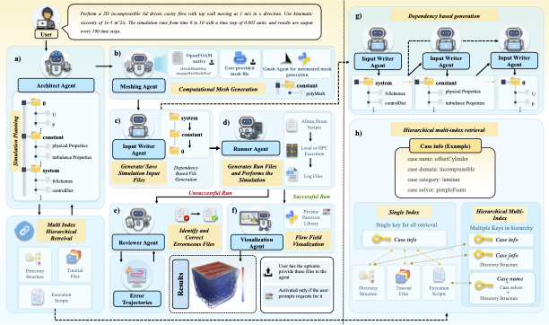

# Foam-Agent    <a href="https://arxiv.org/abs/2505.04997"></a>
<p align="center">
  
</p>

<p align="center">
    <em>An End-to-End Composable Multi-Agent Framework for Automating CFD Simulation in OpenFOAM</em>
</p>

**Foam-Agent** automates the **OpenFOAM**-based CFD simulation workflow from a natural language prompt or an existing case. It manages meshing, case setup, execution, error correction, and optional post-processing. The project's reported [FoamBench](https://arxiv.org/abs/2509.20374) evaluation covers 110 simulation tasks and records a **100% success rate** with Claude Opus 4.6; this is a benchmark result, not a guarantee for arbitrary cases.

Visit [deepwiki.com/csml-rpi/Foam-Agent](https://deepwiki.com/csml-rpi/Foam-Agent) for a comprehensive introduction and to ask questions interactively.

## Key Features

- **End-to-End Workflow**: Meshing with OpenFOAM utilities, generated Gmsh meshes or uploaded Gmsh `.msh` files, case generation, local execution or Slurm submission, and optional PyVista visualization. Execution requires the corresponding runtime and infrastructure.
- **Multi-Agent Workflow**: Architect, Input Writer, Runner, and Reviewer agents collaborate through a LangGraph pipeline with automatic error correction (up to 25 iterations).
- **RAG-Enhanced Generation**: Hierarchical FAISS indices built from OpenFOAM tutorials provide context-specific retrieval for accurate configuration file generation.
- **Composable Service Architecture**: Core functions are exposed as MCP tools, enabling integration with Claude Code, Cursor, and other agentic systems.

## Quick Start

### 1. Pull and run the Docker image

```bash
docker run -it \
  -e FOAMAGENT_MODEL_PROVIDER=openai \
  -e FOAMAGENT_MODEL_VERSION=gpt-5-mini \
  -e OPENAI_API_KEY=your-key-here \
  -p 7860:7860 \
  --name foamagent \
  leoyue123/foamagent
```

The container comes with OpenFOAM v10, Conda, and all dependencies pre-installed.

> For a specific release: `docker pull leoyue123/foamagent:v2.0.0`

### 2. Write your prompt

Edit `user_requirement.txt` inside the container:

```text
do a Reynolds-Averaged Simulation (RAS) pitzdaily simulation. Use PIMPLE algorithm.
The domain is a 2D millimeter-scale channel geometry. Boundary conditions specify a
fixed velocity of 10m/s at the inlet (left), zero gradient pressure at the outlet
(right), and no-slip conditions for walls. Use timestep of 0.0001 and output every
0.01. Finaltime is 0.3. use nu value of 1e-5.
```

### 3. Run

```bash
python foambench_main.py --output ./output --prompt_path ./user_requirement.txt
```

That's it. Foam-Agent will plan the case, generate all OpenFOAM files, run the simulation, and fix errors automatically.

`--output` is used directly; `foambench_main.py` defaults to the repository's `output/` directory. For prompt workflows through the Python API or `src/main.py` without an output directory, each invocation creates a new `run_N` directory under `Config.run_directory` (default `runs/`). Numbering starts at `Config.run_times` (default 1) and skips existing names, preserving earlier runs even when overwrite is enabled.

### 4. Run an Existing Case

Prompt, external-mesh/material and existing-case inputs share the same main graph:

```text
Preparation -> Meshing Planner -> Meshing -> Solver Planner -> Input Writer
            -> Local/HPC Runner -> optional Visualization
```

Preparation creates working copies and supplies file facts. The LLM decides mesh
operations from the requirement and available files; an existing `polyMesh` or
uploaded path does not force reuse or regeneration. Solver selection and solver
reference retrieval happen after the actual mesh is ready. Meshing is an ordinary
node, not a child graph.

For directory/ZIP imports, Preparation preserves a read-only `original/` copy,
creates `work/`, and reads the existing files and script. Header evidence selects
the supported native target; specify `--openfoam_target` when detection is
inconclusive. A configured/detected target conflict stops before mesh planning.
Solver Planner decides the minimum physical changes after mesh handoff and
extracts a solver-only `Allrun`, preserving field preparation and solver arguments.
If required physical information cannot be inferred, planning fails with a reason.

```bash
# Preserve the existing physical definition and run it
python foambench_main.py \
  --output ./output/imported-dam-break \
  --case_path /path/to/damBreak

# Modify an existing case according to a prompt, then run it
python foambench_main.py \
  --output ./output/modified-case \
  --case_path /path/to/case \
  --prompt_path ./requirements.txt \
  --openfoam_target esi-v2006
```

The three main input modes are requirements only, an uploaded Gmsh `.msh` with requirements, and an existing case with optional requirements. `--case_path` and `--custom_mesh_path` may be supplied together, with or without an explicit requirements file. Every combination enters Preparation: it imports the case when supplied, copies the uploaded Gmsh mesh into the working case's `input/`, and passes all available file facts and requirements to Meshing Planner. Request visualization in the prompt for either generated or imported cases; the Planner determines whether it is needed.

`--case_path` accepts either a case directory or a ZIP archive. If an archive contains multiple cases, select one explicitly:

```bash
python foambench_main.py \
  --output ./output/imported-case \
  --case_path ./tutorials.zip \
  --case_subdir multiphase/interFoam/laminar/damBreak/damBreak
```

The task directory contains `original/`, `work/`, and `report/`. `report/case_context.json` records the initial imported context, and `report/logs/` contains workflow logs; local `Allrun.out`, `Allrun.err`, and solver logs remain in `work/`. The solver-only `Allrun` is executed from `work/`; mesh operations execute earlier in Meshing. Import rejects symbolic links in a source case. Replacing a non-empty output directory requires both Foam-Agent's ownership marker and `--overwrite_output` (or the API's `overwrite_output=true`). Import itself does not impose a command whitelist or rewrite the script.

Generated and imported cases share the same review services and configured repair budget. Mesh failures return to the main-graph Reviewer, then Meshing Planner and Meshing for repair. Solver errors return to Reviewer, then Input Writer for physical repairs or Meshing Planner for mesh repairs. Pending solver-file changes survive mesh retries. Planner and Reviewer declare each file's stage rather than routing by its filename. After mesh repair, the mesh planner uses actual results to decide whether Solver Planner must revisit the physics plan. Solver review retains its existing repeated-fingerprint stop rule; mesh review decides whether another repair is justified within the same configured budget. There is no interactive clarification or task-resume step; correct missing inputs identified by a planning failure and start a new run.

If simulation succeeds but requested visualization fails, the workflow reports `partial_success`, `termination_reason=visualization_failed`, and `Simulation completed successfully, but visualization failed.` The CLI exits nonzero; MCP `run_case` returns the message and `visualization_error` separately from execution errors.

## Configuration

Settings live in `src/config.py` with sensible defaults. The supported environment variables below override model, embedding, OpenFOAM fork, and native target selection, which is useful for Docker and CI. Other configuration fields use their Python defaults or explicit CLI/API values.

### LLM Provider and Model

| Environment Variable | Purpose | Allowed Values |
|---|---|---|
| `FOAMAGENT_MODEL_PROVIDER` | LLM backend | `openai`, `openai-codex`, `anthropic`, `bedrock`, `ollama`, `deepseek` |
| `FOAMAGENT_MODEL_VERSION` | Model identifier | A model supported by the selected provider; default `gpt-5.3-codex` |

The default provider is `openai-codex`, which reads an OAuth token cache. Setting `OPENAI_API_KEY` alone does not switch to the `openai` provider; set both provider and model for API-key usage.

Example:
```bash
docker run -it \
  -e FOAMAGENT_MODEL_PROVIDER=anthropic \
  -e ANTHROPIC_API_KEY=your-key-here \
  -e FOAMAGENT_MODEL_VERSION=claude-sonnet-4-6 \
  -p 7860:7860 \
  leoyue123/foamagent
```

### Embedding Provider and Model

| Environment Variable | Purpose | Allowed Values |
|---|---|---|
| `FOAMAGENT_EMBEDDING_PROVIDER` | Embedding backend | `openai`, `huggingface`, `ollama` |
| `FOAMAGENT_EMBEDDING_MODEL` | Embedding model | e.g., `Qwen/Qwen3-Embedding-0.6B`, `text-embedding-3-small` |

Defaults to `huggingface` with `Qwen/Qwen3-Embedding-0.6B` (runs locally, no API key needed).

### API Keys

| Variable | When needed |
|---|---|
| `OPENAI_API_KEY` | Using `openai` provider |
| `ANTHROPIC_API_KEY` | Using `anthropic` provider |
| `DEEPSEEK_API_KEY` | Using `deepseek` provider |
| AWS credentials | Using `bedrock` provider |

### Input Writer Generation Mode

Set in `src/config.py` via `input_writer_generation_mode`:

| Mode | Behavior | Best for |
|---|---|---|
| `sequential_dependency` | Files generated in order with cross-file context | Expensive runs (HPC, long simulations) |
| `parallel_no_context` | Files generated in parallel, no cross-file context | Fast local runs where retry is cheap |

### Reported Benchmark Results

These are the project's recorded benchmark results, not guarantees for the current working tree, native ESI v2006, or arbitrary imported cases.

| Framework | Model | Basic | Advanced |
|---|---|---:|---:|
| FoamAgent 2.0.0 (10 loops) | Opus 4.6 | 85.45% | 100% |
| FoamAgent 2.0.0 (25 loops) | Opus 4.6 | 100% | 100% |
| FoamAgent 2.0.0 (25 loops) | Sonnet 4.6 | 87.88% | 75.00% |
| FoamAgent 2.0.0 (25 loops) | Haiku 4.6 | 54.55% | 37.50% |
| FoamAgent 2.0.0 (25 loops) | gpt-5.4 | 45.45% | 75.00% |
| FoamAgent 2.0.0 (25 loops) | gpt-5.3-codex | 54.55% | 62.50% |

The highest reported scores in this table use **Anthropic Claude Opus 4.6**; model selection remains configurable.

## Advanced Usage

### Mesh handoff and execution

Preparation preserves mesh sources, including time-directory and partition
meshes, until Meshing Planner has selected the operations to perform. The imported
`original/` remains read-only. After successful mesh handoff, Local/HPC Runner
clears prior solver outputs, nonzero time directories and partition directories
before solver execution, preserving the final `constant/polyMesh`. This workflow
does not preserve restart data for continuation runs.

Meshing requires complete final mesh files in `constant/polyMesh`. For parallel
reconstruction, the planner declares a final native reconstruction operation
after the other mesh operations. The executor verifies the declared partition
sources before removing the old serial mesh; reconstruction must then succeed
and produce a complete new serial mesh. Those reconstructed partition sources
may remain until solver cleanup. Other unresolved time/parallel meshes, including
`0/polyMesh`, return to repair; ordinary initial fields in `0/` are preserved.
A zero-time directory containing only auxiliary output such as `cellMap` is allowed.
No latest-time mesh is selected automatically. Tool logs are
archived per attempt under `.foamagent/mesh-logs/` so retries can execute again.

For HPC requests, native mesh commands run through Slurm before solver planning.
Only a completed attempt with its own successful exit result permits the next
stage. Each mesh or solver job uses `Config.max_time_limit` as its total monitoring
deadline, including time spent queued; local mesh-tool execution limits are unchanged.
Resource extraction reads the current decomposition settings before each
stage submission. Explicit submission rejections are repaired using the previous
script and rejection message, consuming the same repair budget as Reviewer.
An uncertain submission result stops the workflow rather than resubmitting.

If monitoring expires or fails, the workflow requests cancellation and waits up
to 60 seconds to confirm that the job has stopped. If this cannot be confirmed,
it stops with `hpc_job_state_unconfirmed`, retaining the job ID and diagnostic
paths, without further repairs or submissions. Slurm commands run in the agent's
existing cluster environment with a shared filesystem; no SSH deployment is added.

The first mesh-file generation precedes tutorial-case retrieval, although
Allmesh command-help retrieval remains available. Complete imported cases also
pass through planning and solver-script extraction.

### Custom Mesh Files

Use `--custom_mesh_path` for an already generated Gmsh `.msh` file (ASCII 2.2), matching Foam-Agent's original custom-mesh input. Preparation copies the supplied file; the LLM selects the mesh operations from the requirement and available files. Existing case-internal `constant/polyMesh` remains supported through case import.

The original `gmsh_mesh` backend still generates and runs Gmsh Python code. External `.geo` execution and independent `polyMesh`-directory upload are not included in this update. Fluent mesh input is deferred to a later SpaceClaim/Fluent integration.

Checks and changes to a case's existing mesh follow the LLM plan. Mesh handoff passes actual boundary text and available evidence to Solver Planner. The absence of a parsed patch summary does not itself fail handoff; a missing required mesh file, including `boundary` or its compressed equivalent, does. Native tool errors enter the existing repair flow. Mesh plans can create or modify files on the first pass, and ordered commands retain repetitions. Allmesh records native output and new or changed logs without assuming log filenames. Meshing Planner decides which startup dictionaries the selected tools require and declares file tasks; execution does not inject default dictionaries. Solver Planner adapts these files to the physical problem where needed.

For example:

```bash
python foambench_main.py \
  --output ./output \
  --prompt_path ./user_req_tandem_wing.txt \
  --custom_mesh_path ./tandem_wing.msh
```

To mount a mesh file from the host into Docker:

```bash
docker run -it \
  -e FOAMAGENT_MODEL_PROVIDER=openai \
  -e FOAMAGENT_MODEL_VERSION=gpt-5-mini \
  -e OPENAI_API_KEY=your-key-here \
  -v /path/to/my_mesh.msh:/home/openfoam/Foam-Agent/my_mesh.msh \
  -p 7860:7860 \
  leoyue123/foamagent
```

### Skill / MCP Integration (Claude Code, Cursor, Windsurf, etc.)

Foam-Agent exposes its full CFD workflow as an **MCP server** — the universal protocol supported by Claude Code, Cursor, Windsurf, and other AI-powered tools. It also ships with a **Claude Code skill** (`/foam`) for one-command simulation runs.

#### Quick Setup (Local Install)

```bash
# 1. Install (adds the foamagent-mcp command)
pip install -e .

# 2. Register with your AI tool
claude mcp add foamagent -- foamagent-mcp                # Claude Code
```

For **Cursor**: open Settings > Features > MCP > Edit MCP Settings, and add:

```json
{
  "mcpServers": {
    "foamagent": {
      "command": "foamagent-mcp"
    }
  }
}
```

For **Windsurf / other MCP-compatible tools**, use the same JSON config above.

#### Quick Setup (Docker)

If running in Docker, start the HTTP server and point your MCP client at it:

```bash
docker run -it \
  -e FOAMAGENT_MODEL_PROVIDER=openai \
  -e FOAMAGENT_MODEL_VERSION=gpt-5-mini \
  -e OPENAI_API_KEY=your-key-here \
  -p 7860:7860 \
  leoyue123/foamagent \
  foamagent-mcp --transport http --host 0.0.0.0 --port 7860
```

Then configure your MCP client:

```json
{
  "mcpServers": {
    "foamagent": {
      "url": "http://localhost:7860/mcp"
    }
  }
}
```

> If running Docker on a remote server, ensure port 7860 is reachable (e.g., via SSH port forwarding or `-p 7860:7860`).

#### Available MCP Tools

Foundation OpenFOAM v10 is the default native target. Set
`FOAMAGENT_OPENFOAM_TARGET=esi-v2006` to select the peer native ESI/OpenCFD v2006 target. Each native target uses its own tutorial/FAISS corpus, dictionary conventions, runtime guard, and Docker image.

`FOAMAGENT_OPENFOAM_FORK=esi` is separate from native target selection: it is a legacy, best-effort Foundation-to-ESI translation compatibility path. It does not select v2006 and is never invoked by `FOAMAGENT_OPENFOAM_TARGET=esi-v2006`.

### Native target capability parity

`foundation-v10` and `esi-v2006` use the same workflow implementation for prompt planning and RAG, file and Allrun generation, standard/Gmsh/custom meshes, local and HPC execution, review/rewrite, visualization, and existing-case import, with target-specific Docker delivery. This is shared code coverage, not a guarantee that every solver or case succeeds. Their solver names and dictionary syntax remain release-native. All non-CAD graph inputs pass Preparation and mesh planning before Solver Planner selects physical changes; Reviewer supplies file repair plans or mesh retries. `FOAMAGENT_OPENFOAM_FORK=esi` is a legacy translation
mode.

Native tutorial corpora are stored by target under `database/`: Foundation v10 uses `database/foundation-v10/{raw,faiss}`, while ESI/OpenCFD v2006 uses `database/esi-v2006/{raw,faiss}`. The sibling `database/script/` directory contains the parsers and FAISS builders shared by both corpora.

| Tool | Description |
|------|-------------|
| `plan` | Analyze requirements and plan simulation structure using the selected native target's references |
| `input_writer` | Generate OpenFOAM configuration files using the selected native conventions; legacy translation is available only through `FOAMAGENT_OPENFOAM_FORK=esi` |
| `run` | Execute Allrun locally with error collection and validate the selected native runtime |
| `review` | Analyze simulation errors and suggest fixes using the selected native target's references |
| `apply_fixes` | Rewrite OpenFOAM files according to the selected native conventions |
| `run_case` | Run or modify an existing directory/ZIP through the complete Planner-to-Reviewer workflow |
| `visualization` | Generate PyVista visualization of simulation results |

#### Claude Code Skill

For Claude Code users who clone this repo, a `/foam` skill is included in `.claude/skills/foam.md`. It orchestrates the MCP tools into a complete workflow:

```
/foam Simulate lid-driven cavity flow at Re=1000
```

This triggers the full pipeline: plan -> generate files -> run -> review/fix loop -> visualize.

This skill orchestrates individual MCP tools on the client, with up to five repair iterations and optional visualization. Those tools do not run the CLI's complete graph automatically; the standalone `run` tool is local-only. Use the CLI graph for generated-case Gmsh/custom-mesh or HPC routing, and `run_case` for the imported-case graph.

### Codex OAuth Sign-in (No API Key)

If you have a ChatGPT/Codex subscription, you can authenticate via OAuth instead of an API key:

1. Install the [Codex CLI](https://github.com/openai/codex) on your host machine.
2. Run `codex login` and choose **"Sign in with ChatGPT"**.
3. Verify the token cache exists: `ls ~/.codex/auth.json`
4. Mount it into the container:

```bash
docker run -it \
  -e FOAMAGENT_MODEL_PROVIDER=openai-codex \
  -e FOAMAGENT_MODEL_VERSION=gpt-5.3-codex \
  -v ~/.codex/auth.json:/root/.codex/auth.json:ro \
  -p 7860:7860 \
  leoyue123/foamagent
```

Foam-Agent searches for OAuth tokens at (first match wins):
- `$CODEX_HOME/auth.json`
- `~/.codex/auth.json`
- `~/.clawdbot/agents/main/agent/auth-profiles.json`

> Security note: `auth.json` contains access tokens. Treat it like a password.

### Manual Installation (Without Docker)

```bash
git clone https://github.com/csml-rpi/Foam-Agent.git
cd Foam-Agent
conda env create -n FoamAgent -f environment.yml
conda activate FoamAgent
```

For the default native target, install and source **Foundation OpenFOAM v10** ([openfoam.org](https://openfoam.org)). For native ESI/OpenCFD v2006, install and source its matching v2006 runtime and select `FOAMAGENT_OPENFOAM_TARGET=esi-v2006` as described below. `FOAMAGENT_OPENFOAM_FORK=esi` remains the separate best-effort translation mode. Follow the [official Foundation v10 installation guide](https://openfoam.org/version/10/) for the default path and verify with:

```bash
echo $WM_PROJECT_DIR   # should print e.g. /opt/openfoam10
```

Then run:

```bash
python foambench_main.py --output ./output --prompt_path ./user_requirement.txt
```

### Native ESI/OpenCFD v2006

Build the isolated ESI v2006 corpus from an ESI v2006 installation, then select the target explicitly. Existing configurations remain unchanged unless this target is supplied.

```bash
# Maintainers: rebuild the versioned v2006 corpus from a sourced ESI/OpenCFD
# v2006 installation. Regular users receive this corpus through Git LFS.
python init_database.py --openfoam_target esi-v2006 \
  --openfoam_path "$WM_PROJECT_DIR" \
  --embedding_provider huggingface --embedding_model Qwen/Qwen3-Embedding-0.6B --force
# If a packaged v2006 runtime omits tutorials, point at tutorials extracted
# from the matching official OpenFOAM-v2006 source archive:
#   --tutorials_path /path/to/OpenFOAM-v2006/tutorials

# Users: clone with Git LFS, then run the selected native target.
git lfs pull
python foambench_main.py --openfoam_target esi-v2006 \
  --output ./output/esi-v2006 --prompt_path ./user_requirement.txt
```

The explicit embedding arguments above build Qwen3-Embedding-0.6B indices, matching the runtime default. Without those arguments, `init_database.py` checks completeness under Qwen 0.6B, but invokes FAISS builders whose defaults are OpenAI/`text-embedding-3-small`. Always supply both arguments; the runtime embedding environment variables do not set the builders' CLI defaults. Omit `--force` to reuse existing raw data and complete selected-model indices. Use `--embedding_provider huggingface --embedding_model Qwen/Qwen3-Embedding-8B` for 8B, or `--embedding_provider openai --embedding_model text-embedding-3-small` for OpenAI. Set the corresponding runtime embedding provider/model when using those indices.

The current Foundation corpus has Qwen 0.6B, Qwen 8B, and OpenAI small index directories; the ESI v2006 corpus has Qwen 0.6B and OpenAI small, but no prebuilt Qwen 8B directory. `init_database.py --database_path` takes a target-specific directory; `Config.database_path` instead takes the parent containing both target directories.

`WM_PROJECT_VERSION` must report `v2006` (or `2006`) at execution time. Building the OpenAI index requires `OPENAI_API_KEY`. Both targets use their own subdirectory under the configured database root and check the corpus manifest, required raw files, and selected embedding indices before loading. HPC jobs use the existing OpenFOAM environment on the compute nodes and check that its version matches the selected target.

### HPC execution and monitoring

The HPC node generates a Slurm script and invokes `sbatch` and `squeue` in the agent's environment. The case path must be accessible to the compute nodes; this code does not upload files or establish an SSH connection. The selected OpenFOAM environment must already be available when the job's runtime guard executes.

An empty `squeue` response ends monitoring, but success also requires the current attempt's zero exit-code record and case-log checks. Monitoring does not query `sacct`. Monitoring failure or deadline expiry triggers cancellation and confirmation that the job has stopped; an unconfirmed stop terminates the workflow with `hpc_job_state_unconfirmed`. See [Mesh handoff and execution](#mesh-handoff-and-execution) for stage deadlines, submission repair and cancellation details.

### Building the Docker Image from Source

```bash
git clone https://github.com/csml-rpi/Foam-Agent.git
cd Foam-Agent
docker build -f docker/Dockerfile -t foamagent:foundation-v10 .
docker run -it \
  -e FOAMAGENT_MODEL_PROVIDER=openai \
  -e FOAMAGENT_MODEL_VERSION=gpt-5-mini \
  -e OPENAI_API_KEY=your-key-here \
  -p 7860:7860 \
  foamagent:foundation-v10
```

The ESI v2006 image requires the versioned `database/esi-v2006/` corpus in the build context. Its Docker build validates that all Git LFS assets are hydrated.

Both images use `/home/openfoam/Foam-Agent`, the same Conda environment setup, and the same startup update policy. ESI v2006 retains a separate source-compilation stage on Ubuntu 20.04; its entrypoint handles the v2006 environment initialization before activating Conda. Both entrypoints update from `csml-rpi/Foam-Agent` by default. Set `FOAMAGENT_SKIP_UPDATE=1` to run the code bundled in the image (including local changes).

```bash
docker build -f docker/Dockerfile.esi-v2006 -t foamagent:esi-v2006 .
docker run -it foamagent:esi-v2006
```

## Troubleshooting

| Problem | Solution |
|---|---|
| OpenFOAM environment not found | Ensure the intended OpenFOAM bashrc is sourced. The default path is Foundation v10; `FOAMAGENT_OPENFOAM_TARGET=esi-v2006` requires an ESI v2006 environment at runtime |
| Database files missing | Ensure the full repo is cloned including `database/`. Native ESI also needs `database/esi-v2006/` built from v2006 tutorials |
| Missing dependencies | `conda env update -n FoamAgent -f environment.yml --prune` |
| API key errors | Ensure the appropriate key is set (`OPENAI_API_KEY`, `ANTHROPIC_API_KEY`, etc.) |
| MCP connection errors | Verify the container is running and port 7860 is accessible |

> **OpenFOAM version:** Foam-Agent targets **Foundation OpenFOAM v10** ([openfoam.org](https://openfoam.org)) by default. `FOAMAGENT_OPENFOAM_FORK=esi` retains the legacy best-effort ESI translation path. `FOAMAGENT_OPENFOAM_TARGET=esi-v2006` selects the separate native ESI/OpenCFD v2006 path. Build `foamagent:foundation-v10` or `foamagent:esi-v2006` for the matching runtime; one image cannot switch OpenFOAM distributions at launch.

## Community

### Join the WeChat community

Chinese-speaking users can join the Foam-Agent WeChat community by adding the volunteer's WeChat account: **ZDSJTUCFD**. The volunteer will invite you to the group.

## Citation
If you use Foam-Agent in your research, please cite our paper:
```bibtex
@article{yue2025foam,
    title = {Foam-Agent: A large language model-based multi-agent framework for automating computational fluid dynamics workflows},
    journal = {Computer Methods in Applied Mechanics and Engineering},
    volume = {461},
    pages = {119271},
    year = {2026},
    issn = {0045-7825},
    author = {Ling Yue and Nithin Somasekharan and Tingwen Zhang and Yadi Cao and Zhangze Chen and Shimin Di and Shaowu Pan}
}

```
